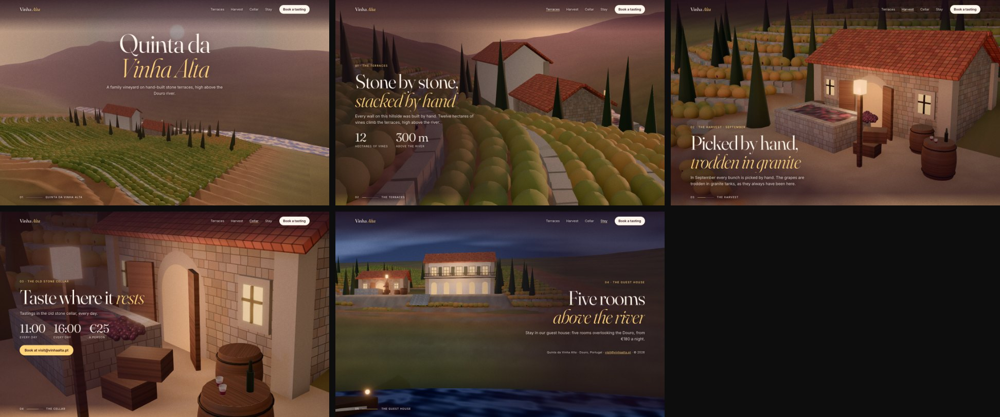
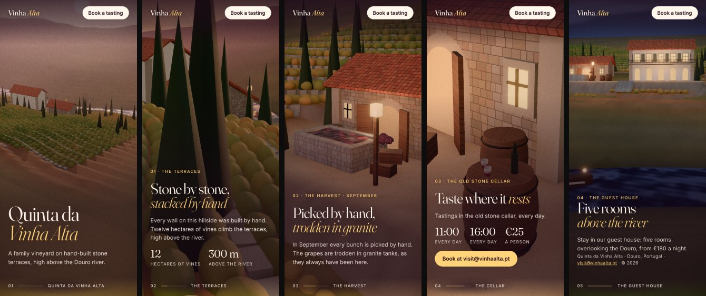
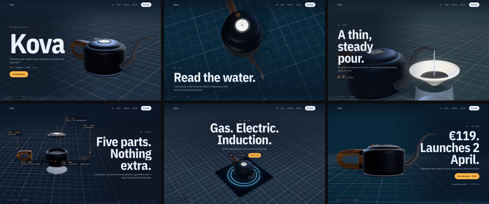

# scene-direction

**Award-level 3D websites from your coding agent.** An agent skill for three.js and WebGL sites: it gives the agent an art direction, real 3D assets, a cinematic rendering pipeline, and a check that films the site the way a jury would see it, on desktop and on a phone.


*Built by an agent with this skill from a one-paragraph brief. No design input, no hand edits.*

## Why

Ask an agent for "an immersive 3D website" and you get the average of every 3D demo it has seen: a glowing orb in a purple night, a dotted globe with arcs, a grey product on a grey floor, the same split layout in every section. It compiles, and nobody remembers it.

The sites that win awards do something else. They have one idea that comes from the subject, a world around the object, a camera that changes shot with every beat of the story, light with a source, type with a voice, and the chrome of a real site. They also run smoothly on a phone. This skill teaches an agent to work that way, then makes it look at what it built.

## Same brief, same model, judged blind

Each pair below was built from the same brief by the same model, once without the skill and once with it. A person picked the better site without knowing which was which.

**A violin maker's portfolio**

| Without the skill | With the skill |
|---|---|
|  |  |

**A headphones launch**

| Without the skill | With the skill |
|---|---|
|  |  |

## More from the skill

**A vineyard in the Douro valley**, dusk to night, on desktop and on a phone:




**The kettle launch**, scene by scene:



## Install

```bash
npx skills add boranfurkan/scene-direction
```

Or copy `skills/scene-direction` into your agent's skills folder. The check needs Node 18+ and Playwright: `npm i -D playwright && npx playwright install chromium`.

Then ask for what you want, as you normally would:

> Build the launch site for our new espresso grinder. I want an immersive, scroll-driven 3D site, the kind that wins awards.

The agent picks up the skill whenever the task is a 3D or WebGL website, section or hero.

## What the agent does with it

1. **Takes stock of what's real.** The subject's name, its objects, its place, its numbers. Real details become the statements on the page.
2. **Gets dealt a direction.** A script deals three of twelve researched directions (night gallery, product noir, golden hour, toy box, daylight still life, blueprint, monolith, fog flyover, material lab, pavilion, paper world, type in space) and writes a sheet with the mood, light, palette, fonts, finish and **a camera shot for every scene**. Recent deals aren't repeated, so a team's sites don't all look alike.
3. **Writes one idea.** *On this site, [something only this subject has] becomes [the direction's world].* If a competitor could use the same sentence, it starts again.
4. **Fetches real assets.** A second script searches Poly Haven's free CC0 library (about 520 scanned models, 870 PBR textures and 1,000 HDRIs), writes a contact sheet to look at, and downloads the picks into the project: the chair, the plank floor, the studio light.
5. **Builds from a starter with the finish built in.** HDRI lighting, ambient occlusion, bloom, vignette, colour-true tone mapping and anti-aliasing. Smooth scrolling, line-by-line text reveals, a two-second intro, a header with a scene index, camera shots fitted to every screen shape, and a camera path for travelling through a place.
6. **Checks its work.** `check.mjs` opens the site in a real browser at 1440×900 and 390×844, films every scene at its resting point, and reloads it with reduced motion. It reports what a visitor or a jury would notice:
   - crashes, blank canvases, failed loads
   - the 3D object cut off, tiny, or covered by the UI
   - text that overlaps, gets clipped, or can't be read against the pixels behind it
   - stretches of the scroll with no words, and a camera that shows the same shot all the way down
   - a layout wider than the phone
   - a hidden native cursor, a missing title, description or `h1`
   - slow frames, a heavy page, an intro that keeps you waiting
7. **Looks and fixes.** It scores its own films against a juror's rubric (idea, signature, colour world, craft, light, drama, atmosphere, type, the live thing, the chrome) and fixes the three weakest things, for up to three rounds.

## Results, honestly

Every version was tested the same way: the same agent and the same brief, with and without the skill, two models, then a person judging each pair blind from the scroll films and the live sites. Later rounds used briefs the skill had never seen.

| Version | Briefs | With the skill vs without |
|---|---|---|
| v3 | 3 full sites × 2 models | 3–3 (fewer defects, but one model's sites came out tame) |
| v4 | 3 new full sites × 2 models | **4–2** |
| v5 | 3 new full sites × 2 models, with real assets, post-processing and site chrome | 3–3 (won both launches; lost both vineyards, where its frames were pale and foggy) |
| v5, retest | the 3 losing briefs, rebuilt after the fix (both sides fresh) | **2–1** |

Every loss taught something specific, and each lesson is now in the skill:
- **v3:** a safe split layout made sites tame. The starter became full-bleed, with a different shot for every scene.
- **v4:** words faded out for most of a short scene. The check now flags a scroll that's mostly wordless.
- **v5:** fog on light grounds washed sites out. Every frame now needs a true dark and a saturated colour.
- **The retest:** a vineyard shown as a small model lost to a camera journey through the terraces. The starter now flies `path` scenes along a route through the world.

The check also catches defects before anyone sees them: in v4 it found no problems on 3 of the 6 sites built with the skill, and on none of the 6 built without it.

## Use it with other skills

The skill owns the 3D direction. For the rest, it works alongside page-design skills ([taste-skill](https://github.com/Leonxlnx/taste-skill), [impeccable](https://github.com/pbakaus/impeccable), [hallmark](https://github.com/Nutlope/hallmark)), the three.js API reference skills ([cloudai-x/threejs-skills](https://github.com/cloudai-x/threejs-skills)) and the official [GSAP skills](https://github.com/greensock/gsap-skills).

## Credits

The dealt directions, the idea sentence, the competitor test, "one live thing", the look-and-fix loop and the lesson that restraint alone reads thin are adapted from [taste-skill](https://github.com/Leonxlnx/taste-skill) (MIT). The signature and the rotation of directions come from [hallmark](https://github.com/Nutlope/hallmark) (MIT), the Experience mode from [impeccable](https://github.com/pbakaus/impeccable) (Apache-2.0), and the archetype vocabulary from [awwwards-3d](https://github.com/tsogjavklann/awwwards-3d) (MIT). The motion rules draw on [emilkowalski/skills](https://github.com/emilkowalski/skills). The assets come from [Poly Haven](https://polyhaven.com) (CC0). The starter runs on [three.js](https://threejs.org), [postprocessing](https://github.com/pmndrs/postprocessing), [N8AO](https://github.com/N8python/n8ao), [GSAP](https://gsap.com) and [Lenis](https://github.com/darkroomengineering/lenis). The worked example is [furkanboran.info](https://www.furkanboran.info).

## License

MIT
