<p align="center">
  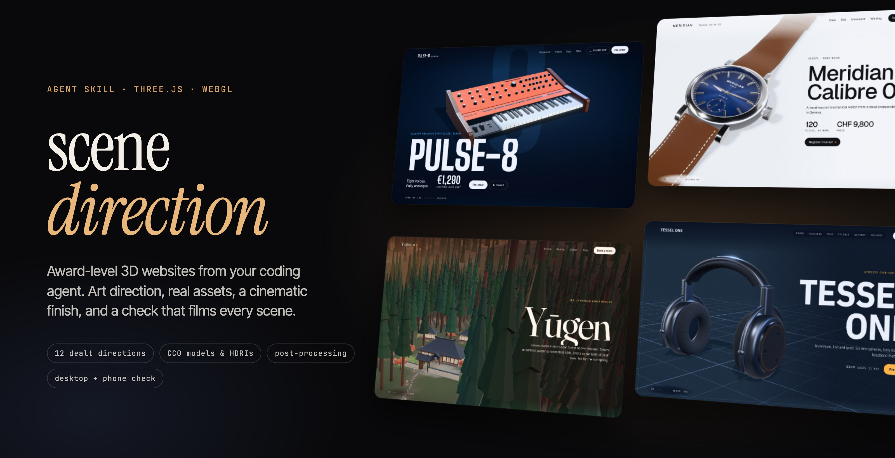
</p>

<h3 align="center">Award-level 3D websites from your coding agent.</h3>

<p align="center">
  An agent skill for three.js and WebGL sites. It gives your agent an art direction, real 3D assets, a cinematic rendering pipeline,<br>
  and a check that films every scene of the site on desktop and on a phone, then fixes what it sees.
</p>

<p align="center"><code>npx skills add boranfurkan/scene-direction</code></p>

<br>

<table>
  <tr>
    <td width="50%">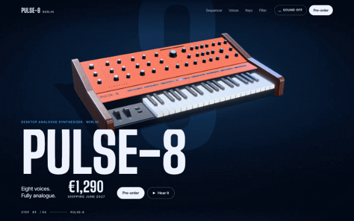</td>
    <td width="50%">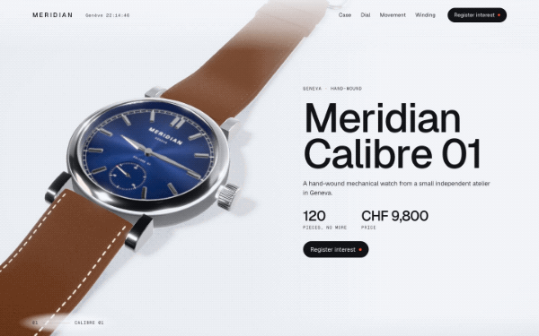</td>
  </tr>
  <tr>
    <td><b>Pulse-8</b>, an analogue synthesizer. Dealt <i>Product noir</i>: the orange panel glows in a deep blue studio, the sequencer lights step by step, and the filter plays a sound you can shape.</td>
    <td><b>Meridian Calibre 01</b>, a mechanical watch. Dealt <i>Material lab</i>: steel, sapphire and a hand-finished movement up close, and you hold a button to wind it.</td>
  </tr>
  <tr>
    <td>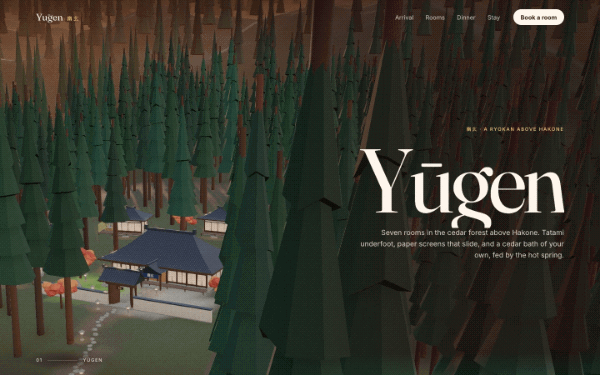</td>
    <td>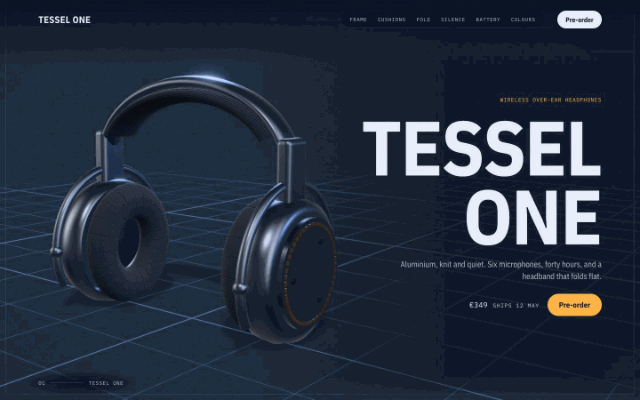</td>
  </tr>
  <tr>
    <td><b>Yūgen</b>, a ryokan in the forest above Hakone. Dealt <i>Golden hour</i>: the camera walks the stone path through the cedars, past the lanterns, into the rooms.</td>
    <td><b>Tessel One</b>, a headphones launch. Dealt <i>Blueprint</i>: the headphones come apart like an engineering drawing, every part labelled with a real fact.</td>
  </tr>
  <tr>
    <td>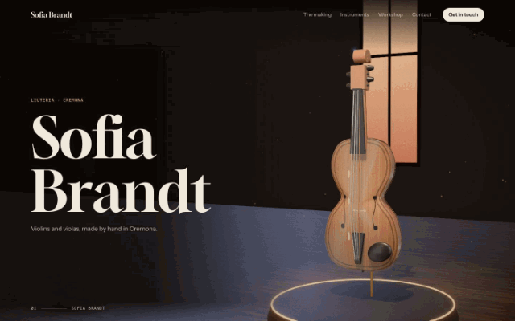</td>
    <td>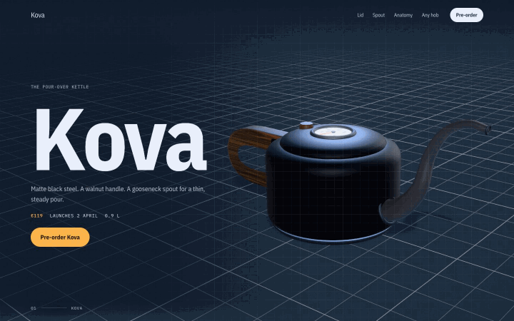</td>
  </tr>
  <tr>
    <td><b>Sofia Brandt</b>, a violin maker. Dealt <i>Night gallery</i>: each instrument stands in its own pool of light, with the making told in numbers.</td>
    <td><b>Kova</b>, a kettle launch. The thermometer climbs as you scroll, the gooseneck pours into a dripper, and the kettle comes apart into its five parts.</td>
  </tr>
</table>

<p align="center"><b>And on a phone</b>, every scene is refitted for portrait:</p>

<table>
  <tr>
    <td width="33%" align="center">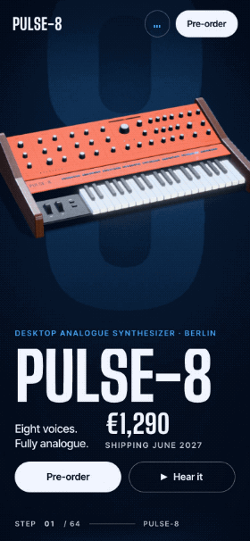</td>
    <td width="33%" align="center">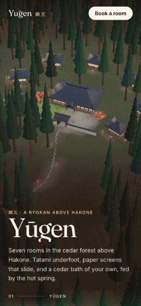</td>
    <td width="33%" align="center"></td>
  </tr>
</table>

<p align="center"><sub>Every site here was built by an agent with the skill, from a one-paragraph brief, with no design input.</sub></p>

## Why

Ask an agent for "an immersive 3D website" and you get the average of every 3D demo it has seen: a glowing orb in a purple night, a dotted globe with arcs, a grey product on a grey floor, the same split layout in every section. It runs, and nobody remembers it.

The sites that win awards do something else. They have one idea that comes from the subject, a world around the object, a camera that changes shot with every beat of the story, light with a source, type with a voice, and the chrome of a real site. And they run smoothly on a phone. This skill teaches an agent to work that way, then makes it look at what it built.

## Same brief, same model: without and with the skill

**A violin maker's portfolio**

| Without the skill | With the skill |
|---|---|
| 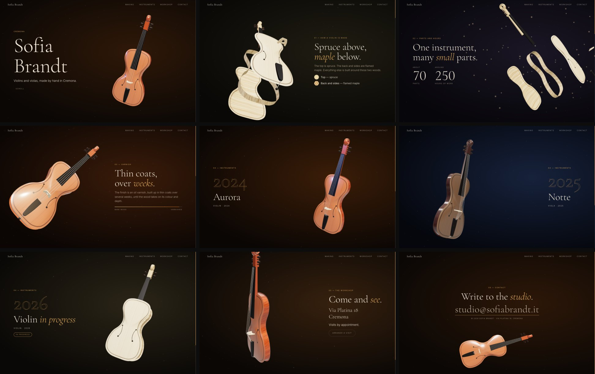 | 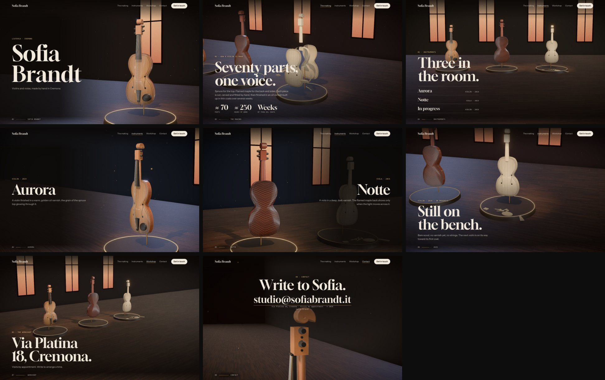 |

**A headphones launch**

| Without the skill | With the skill |
|---|---|
| 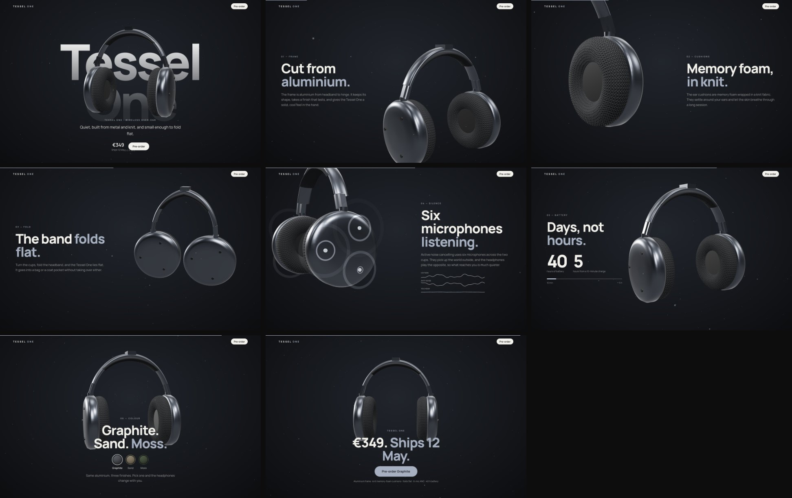 | 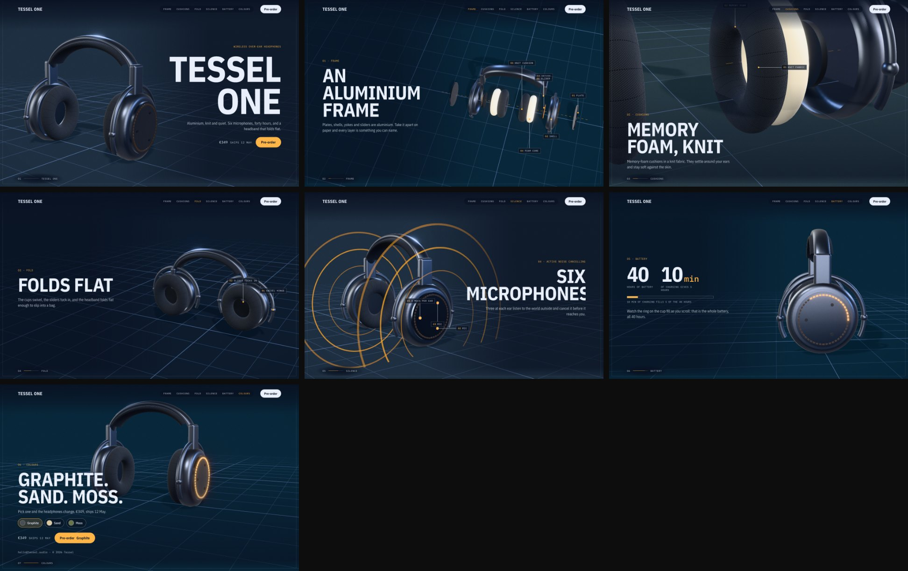 |

## Install

```bash
npx skills add boranfurkan/scene-direction
```

Or copy `skills/scene-direction` into your agent's skills folder. The check needs Node 18+ and Playwright (`npm i -D playwright && npx playwright install chromium`).

Then ask for what you want, the way you normally would:

> Build the launch site for our new espresso grinder. I want an immersive, scroll-driven 3D site, the kind that wins awards.

The agent picks the skill up whenever the task is a 3D or WebGL website, section or hero.

## What the agent does with it

1. **Takes stock of what's real**: the subject's name, its objects, its place, its numbers. Real details become the statements on the page.
2. **Gets dealt a direction.** A script deals three of twelve directions (night gallery, product noir, golden hour, toy box, daylight still life, blueprint, monolith, fog flyover, material lab, pavilion, paper world, type in space) and writes a sheet with the mood, light, palette, fonts, finish and **a camera shot for every scene**. Recent deals aren't repeated, so your sites don't all look alike.
3. **Writes one idea.** *On this site, [something only this subject has] becomes [the direction's world].* If a competitor could use the same sentence, it starts again.
4. **Fetches real assets.** A second script searches Poly Haven's free CC0 library (about 520 scanned models, 870 PBR textures and 1,000 HDRIs), makes a contact sheet to look at, and downloads the picks into the project.
5. **Builds from a starter with the finish built in**: HDRI lighting, ambient occlusion, bloom, vignette, colour-true tone mapping, smooth scrolling, line-by-line text reveals, a two-second intro, a header with a scene index, camera shots fitted to every screen shape, and camera paths for travelling through a place.
6. **Checks its work.** `check.mjs` opens the site in a real browser at 1440×900 and 390×844, films every scene at its resting point, and reloads it with reduced motion. It reports what a visitor or a jury would notice:
   - crashes, blank canvases, failed loads
   - the 3D object cut off, tiny, or covered by the UI
   - text that overlaps, gets clipped, or can't be read against the pixels behind it
   - stretches of the scroll with no words, and a camera that shows the same shot all the way down
   - a layout wider than the phone
   - a hidden native cursor, a missing title, description or `h1`
   - slow frames, a heavy page, an intro that keeps you waiting
7. **Looks and fixes.** It scores its own films against a juror's rubric (idea, signature, colour world, craft, light, drama, atmosphere, type, the one live thing, the chrome) and fixes the three weakest things, for up to three rounds.

## Use it with other skills

The skill owns the 3D direction. For the rest, it works alongside page-design skills ([taste-skill](https://github.com/Leonxlnx/taste-skill), [impeccable](https://github.com/pbakaus/impeccable), [hallmark](https://github.com/Nutlope/hallmark)), the three.js API reference skills ([cloudai-x/threejs-skills](https://github.com/cloudai-x/threejs-skills)) and the official [GSAP skills](https://github.com/greensock/gsap-skills).

## Credits

The dealt directions, the idea sentence, the competitor test, "one live thing", the look-and-fix loop and the lesson that restraint alone reads thin are adapted from [taste-skill](https://github.com/Leonxlnx/taste-skill) (MIT). The signature and the rotation of directions come from [hallmark](https://github.com/Nutlope/hallmark) (MIT), the Experience mode from [impeccable](https://github.com/pbakaus/impeccable) (Apache-2.0), and the archetype vocabulary from [awwwards-3d](https://github.com/tsogjavklann/awwwards-3d) (MIT). The motion rules draw on [emilkowalski/skills](https://github.com/emilkowalski/skills). The assets come from [Poly Haven](https://polyhaven.com) (CC0). The starter runs on [three.js](https://threejs.org), [postprocessing](https://github.com/pmndrs/postprocessing), [N8AO](https://github.com/N8python/n8ao), [GSAP](https://gsap.com) and [Lenis](https://github.com/darkroomengineering/lenis). The worked example is [furkanboran.info](https://www.furkanboran.info).

## License

MIT
